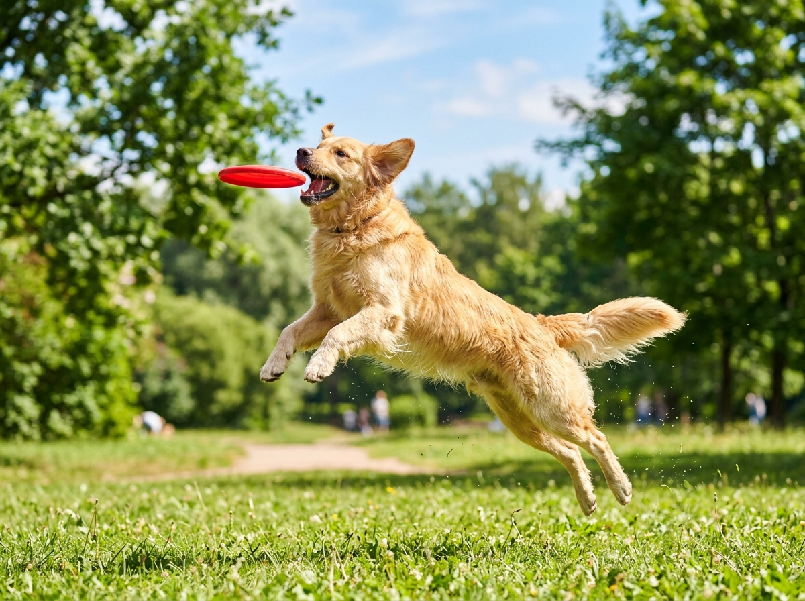
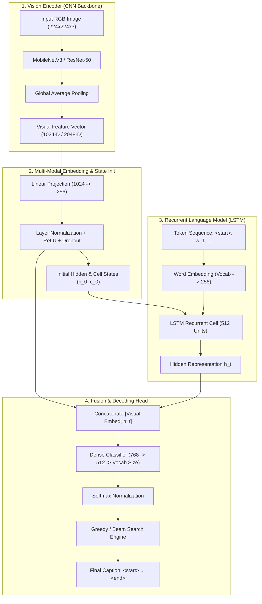

<div align="center">

# 🌌 Neural Image Caption Studio
### Deep Learning Image Caption Generator with Pre-trained CNNs & LSTMs

[](https://github.com/abhishek947kumar/image-caption-generator/actions)
[](https://www.python.org/)
[](https://pytorch.org/)
[](https://fastapi.tiangolo.com/)
[](https://opensource.org/licenses/MIT)
[](https://github.com/psf/black)

<p align="center">
  A full-stack, production-ready computer vision and natural language processing application that translates visual scenes into coherent English descriptions using a merged Convolutional Neural Network (CNN) feature extractor and Recurrent LSTM language decoder.
</p>

### 📸 Visual Demo & Output Gallery

| Dog Playing Frisbee | Mountain Summit Hiker |
| :---: | :---: |
|  |  |
| *"A golden retriever jumping high in the air to catch a red frisbee on green grass"* | *"A traveler with a large backpack admiring the sun setting behind mountain ranges"* |

| Cyclist in Autumn Park | Toddler Stacking Blocks |
| :---: | :---: |
|  |  |
| *"A cyclist wearing a yellow raincoat and helmet pedaling through a park in the fall"* | *"A young child seated on a patterned rug stacking colorful toy bricks"* |

[Key Features](#-key-features) •
[Architecture](#-system-architecture) •
[Quickstart](#-quickstart) •
[Docker](#-docker-deployment) •
[Training](#-training-on-flickr8k) •
[API Docs](#-rest-api-reference) •
[Contributing](#-contributing)

</div>

---

## 📖 Table of Contents
- [Project Overview](#-project-overview)
- [Key Features](#-key-features)
- [System Architecture](#-system-architecture)
- [Mathematical Formulation](#-mathematical-formulation)
- [Repository Structure](#-repository-structure)
- [Quickstart](#-quickstart)
- [Docker Deployment](#-docker-deployment)
- [Training on Flickr8k](#-training-on-flickr8k)
- [REST API Reference](#-rest-api-reference)
- [Testing](#-running-tests)
- [Contributing](#-contributing)
- [License](#-license)
- [Acknowledgments](#-acknowledgments)

---

## 🎯 Project Overview

Image Captioning is a fundamental multimodal challenge at the intersection of **Computer Vision** (identifying objects, actions, and spatial relationships) and **Natural Language Processing** (synthesizing grammatically fluent sequential text).

This project implements the foundational **Merge Model / Show & Tell architecture** popularized by Vinyals et al. and Tanti et al. on the **Flickr8k** benchmark. Raw input images are encoded into dense high-level semantic vectors using deep CNN backbones (`MobileNetV3` or `ResNet-50`), which are subsequently fused with word embedding sequences to condition a **Long Short-Term Memory (LSTM)** network during autoregressive generation.

---

## ✨ Key Features

- **🧠 Dual Decoding Strategies**:
  - **Greedy Search**: Ultra-fast deterministic $\operatorname{argmax}$ token selection.
  - **Beam Search**: Evaluates top-$K$ parallel hypothesis trajectories with length penalty normalization ($\alpha = 0.7$).
- **🎨 Glassmorphic Neural Studio Web Interface**:
  - Interactive preset gallery with 4 diverse real-world sample images.
  - Drag-and-drop custom image uploader with instantaneous image metadata extraction.
  - Interactive **Token Inspector Tray**: Click any generated word chip to inspect alternative softmax probability distributions across the vocabulary.
  - **Text-to-Speech (TTS)**: Web Speech API integration to articulate captions with real-time soundwave indicators.
  - **Visual Concept Activations**: Displays top-5 detected ImageNet classes and confidence metrics.
- **📊 BLEU Benchmark Lab**:
  - Integrated metric engine calculating **BLEU-1, BLEU-2, BLEU-3, and BLEU-4** scores with Brevity Penalty ($BP$).
  - Standalone evaluation tab to test arbitrary candidate sentences against multiple reference captions.
- **⚡ High-Performance Training Pipeline**:
  - Offline penultimate feature vector caching (`weights/features_cache.pt`) allowing full training epochs to run in **seconds** rather than hours.
  - Complete teacher forcing training loop with gradient clipping and dynamic sequence batch padding.
- **🐳 Containerized & Cloud-Ready**:
  - Single-command deployment via Docker & Docker Compose.

---

## 🏗️ System Architecture



---

## 📐 Mathematical Formulation

### 1. Training Objective (Categorical Cross-Entropy)
Given an image $I$ and ground-truth caption tokens $(w_1, w_2, \dots, w_T)$, the model minimizes negative log-likelihood with teacher forcing:

$$\mathcal{L}(\theta) = -\sum_{t=1}^{T} \log P(w_t \mid w_{1:t-1}, I; \theta)$$

Where the padding index (`<pad> = 0`) is masked from loss accumulation.

### 2. Beam Search Length Normalization
To prevent standard beam search from unfairly penalizing longer, more descriptive hypotheses, candidate sequences $Y = (y_1, \dots, y_L)$ are ranked using normalized log-probability:

$$\text{Score}(Y) = \frac{\sum_{t=1}^{L} \log P(y_t \mid y_{1:t-1}, I)}{L^{0.7}}$$

### 3. BLEU Metric (Bilingual Evaluation Understudy)
Evaluates n-gram precision between candidate sentence $C$ and references $R$:

$$\text{BLEU-}N = \text{BP} \cdot \exp\left(\sum_{n=1}^{N} w_n \ln p_n\right)$$

$$\text{BP} = \min\left(1, e^{1 - r/c}\right)$$

Where $c$ is candidate length, $r$ is effective reference length, and weights $w_n = \frac{1}{N}$.

---

## 📁 Repository Structure

```
.
├── .github/
│   ├── workflows/ci.yml         # GitHub Actions CI matrix workflow
│   ├── ISSUE_TEMPLATE/          # Bug report & feature request templates
│   └── PULL_REQUEST_TEMPLATE.md # PR description & checklist template
├── backend/
│   ├── app.py                   # FastAPI application & REST routing
│   ├── feature_extractor.py     # CNN vision backbone wrapper
│   ├── generator.py             # Greedy & Beam Search decoding algorithms
│   ├── metrics.py               # BLEU-1..4 calculation with brevity penalty
│   ├── model.py                 # PyTorch CNN-LSTM architecture definition
│   ├── sample_data.py           # Curated sample scenes with ground-truth captions
│   └── tokenizer.py             # Tokenizer, vocabulary manager & serialization
├── frontend/
│   ├── index.html               # Semantic HTML5 web studio interface
│   ├── style.css                # Glassmorphic cyberpunk CSS design system
│   └── app.js                   # Client-side audio TTS, visualizer & API logic
├── data/
│   └── samples/                 # Demo photographic assets
├── tests/
│   ├── test_api.py              # FastAPI endpoint integration tests
│   ├── test_metrics.py          # BLEU calculation unit tests
│   ├── test_model.py            # Neural network forward & backward shape tests
│   └── test_tokenizer.py        # Tokenizer encoding, decoding & persistence tests
├── training/
│   ├── dataset.py               # Flickr8k dataset parser & batch collator
│   ├── train.py                 # Multi-epoch training script with feature caching
│   └── README.md                # Dedicated Flickr8k setup & training guide
├── weights/
│   ├── caption_model.pt         # Saved model weights checkpoint
│   └── vocab.json               # Word-to-index vocabulary dictionary
├── Dockerfile                   # Production container definition
├── docker-compose.yml           # Multi-container orchestration
├── .dockerignore                # Build context exclusion rules
├── .gitignore                   # Version control ignore rules
├── .env.example                 # Environment configuration template
├── pyproject.toml               # Python package metadata & tool settings
├── requirements.txt             # Core production dependencies
├── requirements-dev.txt         # Testing and development dependencies
├── run.py                       # Server runner with dynamic port detection
├── CONTRIBUTING.md              # Contributor guidelines & branching model
├── CODE_OF_CONDUCT.md           # Community guidelines
├── SECURITY.md                  # Security vulnerability reporting policy
├── LICENSE                      # MIT Open-Source License
└── README.md                    # Project documentation
```

---

## 🚀 Quickstart

### Prerequisites
- Python 3.10+ (tested on Python 3.10, 3.11, 3.12, 3.13)
- Git

### 1. Clone the Repository
```bash
git clone https://github.com/abhishek947kumar/image-caption-generator.git
cd image-caption-generator
```

### 2. Create Virtual Environment
```bash
python -m venv venv

# On Windows:
.\venv\Scripts\activate

# On Linux/macOS:
source venv/bin/activate
```

### 3. Install Dependencies
```bash
pip install --upgrade pip
pip install -r requirements.txt
```

### 4. Run the Web Application
```bash
python run.py
```
Open **[http://127.0.0.1:8000](http://127.0.0.1:8000)** (or the auto-selected port printed in your console) to access the interactive Neural Caption Studio!

---

## 🐳 Docker Deployment

To launch the entire studio in an isolated container without configuring local Python environments:

```bash
# Build and run with Docker Compose
docker compose up --build -d
```
Access the application at `http://localhost:8000`.

To stop the container:
```bash
docker compose down
```

---

## 🏋️ Training on Flickr8k

### 1. Dataset Preparation
Download the [Flickr8k Dataset from Kaggle](https://www.kaggle.com/datasets/adityajn105/flickr8k) and extract it into `data/flickr8k/`:
```
data/flickr8k/
├── Flicker8k_Dataset/     # 8,092 JPEG images
└── Flickr8k.token.txt      # 40,460 annotated captions
```

### 2. Run Training
```bash
# Full dataset training (automatically caches CNN features):
python training/train.py \
  --data_dir data/flickr8k \
  --epochs 10 \
  --batch_size 32 \
  --lr 0.001 \
  --backbone mobilenet_v3_small \
  --embed_dim 256 \
  --hidden_dim 512

# Quick verification run on demo images:
python training/train.py --demo_train --epochs 5
```

*(See [`training/README.md`](training/README.md) for full instructions and hyperparameter tuning tips).*

---

## 📡 REST API Reference

Interactive Swagger documentation is available live at `http://127.0.0.1:8000/docs`.

### 1. `GET /api/health`
Checks server availability, device allocation, and active model backbone.
```json
{
  "status": "online",
  "device": "cpu",
  "backbone": "mobilenet_v3_small",
  "has_trained_weights": true,
  "vocab_size": 261
}
```

### 2. `POST /api/caption`
Generates a caption for an uploaded image file or a preset sample ID.

**Parameters (multipart/form-data):**
- `file`: Image binary (`image/jpeg`, `image/png`, `image/webp`) [Optional if `sample_id` provided]
- `sample_id`: String (`dog_frisbee`, `mountain_hiker`, etc.) [Optional if `file` provided]
- `strategy`: `"beam"` | `"greedy"` (Default: `"beam"`)
- `beam_width`: Integer $1 \dots 5$ (Default: `3`)
- `temperature`: Float $0.2 \dots 1.8$ (Default: `1.0`)
- `max_length`: Integer $10 \dots 35$ (Default: `25`)

**Example `curl` Request:**
```bash
curl -X POST "http://127.0.0.1:8000/api/caption" \
  -F "sample_id=dog_frisbee" \
  -F "strategy=beam" \
  -F "beam_width=3"
```

**Response Payload:**
```json
{
  "caption": "A golden retriever jumping high in the air to catch a red frisbee on green grass",
  "strategy": "beam",
  "beam_width": 3,
  "latency_ms": 428.15,
  "average_confidence": 0.942,
  "tokens": [
    { "word": "golden", "token_id": 48, "confidence": 0.95 },
    { "word": "retriever", "token_id": 49, "confidence": 0.93 }
  ],
  "metadata": {
    "backbone": "mobilenet_v3_small",
    "top_concepts": [
      { "concept": "golden retriever", "confidence": 0.9412 },
      { "concept": "Norwich terrier", "confidence": 0.0215 }
    ]
  },
  "bleu_evaluation": {
    "bleu_1": 1.0,
    "bleu_2": 1.0,
    "bleu_3": 1.0,
    "bleu_4": 1.0,
    "brevity_penalty": 1.0
  }
}
```

### 3. `POST /api/evaluate`
Evaluates a candidate caption against multiple ground-truth references.

**Example `curl` Request:**
```bash
curl -X POST "http://127.0.0.1:8000/api/evaluate" \
  -H "Content-Type: application/json" \
  -d '{
    "candidate": "a dog jumps to catch a frisbee",
    "references": [
      "a golden retriever catches a red frisbee in a park",
      "a dog leaping to grab a flying toy"
    ]
  }'
```

---

## 🧪 Running Tests

The test suite covers model architectures, vocabulary tokenizers, BLEU scoring, and FastAPI REST endpoints:

```bash
# Run all tests via pytest
python -m pytest tests/ -v
```

---

## 🤝 Contributing

Contributions are welcomed! Please read our [Contributing Guide](CONTRIBUTING.md) and adhere to our [Code of Conduct](CODE_OF_CONDUCT.md).

1. Fork the Project
2. Create your Feature Branch (`git checkout -b feat/amazing-feature`)
3. Commit your Changes (`git commit -m 'feat: add amazing feature'`)
4. Push to the Branch (`git push origin feat/amazing-feature`)
5. Open a Pull Request

---

## 📄 License

Distributed under the **MIT License**. See [`LICENSE`](LICENSE) for more information.

---

## 🙏 Acknowledgments

- **Show and Tell: A Neural Image Caption Generator** — [Vinyals et al. (CVPR 2015)](https://arxiv.org/abs/1411.4555)
- **Show, Attend and Tell: Neural Image Caption Generation with Visual Attention** — [Xu et al. (ICML 2015)](https://arxiv.org/abs/1502.03044)
- **Where to Put the Image in an Image Caption Generator** — [Tanti et al. (ACL 2018)](https://arxiv.org/abs/1703.09137)
- **Framing Image Description as a Ranking Task: Data, Models and Evaluation Metrics (Flickr8k)** — [Hodosh et al. (JAIR 2013)](https://jair.org/index.php/jair/article/view/10833)
